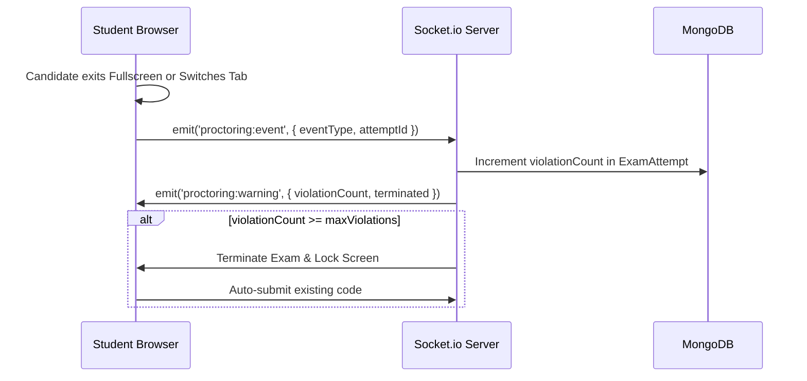
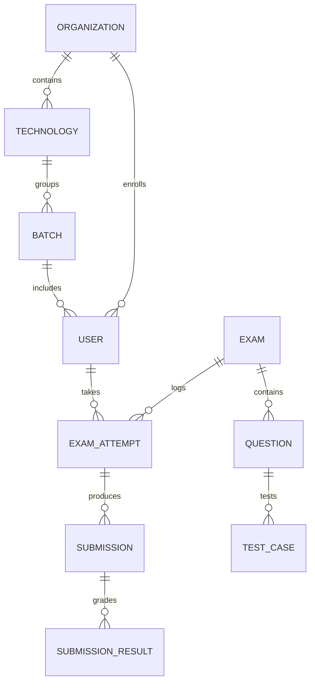

# Ducat Assessment Tool (CDT) - Developer Architecture Bible & Codebase Book
## The Complete Engineering Guide: Architecture, Source Code, AI Subsystems & Extension Playbook

---

# Table of Contents
1. [System Architecture & Core Philosophy](#1-system-architecture--core-philosophy)
2. [Complete Technology Stack](#2-complete-technology-stack)
3. [Global Directory Map](#3-global-directory-map)
4. [Backend Codebase: Exhaustive File-by-File Breakdown](#4-backend-codebase-exhaustive-file-by-file-breakdown)
   - [4.1 Entry Points & Sockets](#41-entry-points--sockets)
   - [4.2 Configuration Files](#42-configuration-files)
   - [4.3 Mongoose Database Models (13 Models)](#43-mongoose-database-models-13-models)
   - [4.4 Controllers (11 Controllers)](#44-controllers-11-controllers)
   - [4.5 Business Services (10 Services)](#45-business-services-10-services)
   - [4.6 Docker Sandbox Execution Engine](#46-docker-sandbox-execution-engine)
   - [4.7 BullMQ Queues & Evaluation Workers](#47-bullmq-queues--evaluation-workers)
   - [4.8 Middlewares & Security Layer](#48-middlewares--security-layer)
   - [4.9 Express API Routes](#49-express-api-routes)
   - [4.10 Scripts & Seeders](#410-scripts--seeders)
   - [4.11 Utilities & Validators](#411-utilities--validators)
5. [Frontend Codebase: Exhaustive Component & Page Breakdown](#5-frontend-codebase-exhaustive-component--page-breakdown)
   - [5.1 Application Core & State Providers](#51-application-core--state-providers)
   - [5.2 Global API Client & Interceptors](#52-global-api-client--interceptors)
   - [5.3 Layout Wrappers](#53-layout-wrappers)
   - [5.4 Candidate & Student Pages (11 Pages)](#54-candidate--student-pages-11-pages)
   - [5.5 Administrator & Faculty Pages (15 Pages)](#55-administrator--faculty-pages-15-pages)
   - [5.6 Admin AI Intelligence & Generation Components (6 Components)](#56-admin-ai-intelligence--generation-components-6-components)
   - [5.7 Frontend Utilities](#57-frontend-utilities)
6. [Local Ollama AI Engine & Synthesis Architecture](#6-local-ollama-ai-engine--synthesis-architecture)
   - [6.1 Local Daemon Communication & Model Discovery](#61-local-daemon-communication--model-discovery)
   - [6.2 Resilient JSON Repair Engine (`tryRepairJson`)](#62-resilient-json-repair-engine-tryrepairjson)
   - [6.3 Automatic Language Normalization Subsystem](#63-automatic-language-normalization-subsystem)
   - [6.4 Extended 10-Minute Timeout & Progress Estimation Pipeline](#64-extended-10-minute-timeout--progress-estimation-pipeline)
   - [6.5 100% Local Ephemeral Privacy Guarantee & Data-Cut Protocol](#65-100-local-ephemeral-privacy-guarantee--data-cut-protocol)
7. [Persistent Exam Session & Anti-Exit Lockdown Architecture](#7-persistent-exam-session--anti-exit-lockdown-architecture)
   - [7.1 Backend Active Session Tracking (`/api/exams/active-session`)](#71-backend-active-session-tracking-apiexamsactive-session)
   - [7.2 Frontend Route Trapping & Interception (`App.jsx`)](#72-frontend-route-trapping--interception-appjsx)
   - [7.3 History Interception, Autosave & Resilient State Hydration](#73-history-interception-autosave--resilient-state-hydration)
8. [Multi-Language Docker Sandbox Engine](#8-multi-language-docker-sandbox-engine)
9. [Proctoring & Anti-Cheat Security Subsystem](#9-proctoring--anti-cheat-security-subsystem)
10. [Queue-Based Evaluation & Auto-Healing Subsystem](#10-queue-based-evaluation--auto-healing-subsystem)
11. [Database Entity-Relationship Architecture](#11-database-entity-relationship-architecture)
12. [Developer Playbook: How to Extend Anything](#12-developer-playbook-how-to-extend-anything)
    - [12.1 How to Add a New Programming Language (e.g., Go, Rust)](#121-how-to-add-a-new-programming-language)
    - [12.2 How to Add a New Question Type](#122-how-to-add-a-new-question-type)
    - [12.3 How to Configure Remote or GPU Ollama Clusters](#123-how-to-configure-remote-or-gpu-ollama-clusters)
    - [12.4 How to Modify Proctoring & Anti-Cheat Rules](#124-how-to-modify-proctoring--anti-cheat-rules)
    - [12.5 How to Modify Scoring, Partial Grading & Decimals](#125-how-to-modify-scoring-partial-grading--decimals)
    - [12.6 How to Deploy to Production VPS](#126-how-to-deploy-to-production-vps)

---

# 1. System Architecture & Core Philosophy

The Ducat Coding & Assessment Tool (CDT) is designed as a high-throughput, distributed online testing system engineered to withstand high-concurrency exam submissions, untrusted arbitrary code execution, and aggressive anti-cheating enforcement.

### Architectural Diagram
```
                     ┌─────────────────────────────────────────────────────────┐
                     │                  React + Vite Frontend                  │
                     │  (Monaco Editor, Socket.io, Tailwind CSS, Lucide Icons) │
                     └────────────┬───────────────────────────────┬────────────┘
                                  │                               │
                       HTTPS REST │                    WebSocket  │ (WSS Proctoring)
                                  │                               │
                     ┌────────────▼───────────────────────────────▼────────────┐
                     │                 Express.js API Gateway                  │
                     │  (Auth, Active Session Lock, Proctoring Hub, Exam CRUD) │
                     └──────┬─────────────┬─────────────┬─────────────┬────────┘
                            │             │             │             │
                   MongoDB  │    BullMQ   │    Docker   │    Local    │
                 (Database) │    (Redis)  │   (Daemon)  │    Ollama   │
                            ▼             ▼             ▼             ▼
                     ┌──────────┐  ┌──────────┐  ┌──────────┐  ┌──────────────┐
                     │ Mongoose │  │Evaluator │  │Container │  │ On-Premises  │
                     │ Cluster  │  │ Workers  │  │ Sandbox  │  │ Local LLMs   │
                     └──────────┘  └──────────┘  └──────────┘  └──────────────┘
```

### Architectural Tenets
1. **Zero Trust Code Execution**: Student source code is never executed on the host server. Every execution runs in an ephemeral, memory-limited, CPU-throttled, network-isolated Docker container.
2. **Asynchronous Non-Blocking Evaluation**: Submitting an exam immediately shifts the student's status to `EVALUATING` and offloads grading to a Redis-backed BullMQ queue. The API remains responsive even when 1,000 students submit simultaneously.
3. **Persistent Exam Session Lockdown**: When a student starts an exam, the attempt is sealed to `IN_PROGRESS`. If the student refreshes, closes the tab, copies the link to another window, or clicks the browser's back button, CDT intercepts the navigation and returns them directly to the active exam until official submission or timer expiration.
4. **100% Local AI Data Sovereignty**: All AI exam generation, question synthesis, candidate code reviews, and institutional cohort analyses run strictly against a local Ollama daemon (`http://127.0.0.1:11434`). Zero proprietary questions or student scores are transmitted to external cloud providers.
5. **Self-Healing Scores**: If an unexpected network interruption occurs during background evaluation, the platform includes self-healing logic that recalculates and seals attempt scores whenever results are requested.

---

# 2. Complete Technology Stack

| Layer | Technology | Version / Spec | Purpose |
| :--- | :--- | :--- | :--- |
| **Runtime** | Node.js | `>= 18.x` (LTS) | Asynchronous JavaScript backend runtime. |
| **Web Framework** | Express.js | `^4.18.2` | RESTful API server, routing, and controller middleware. |
| **Realtime Engine** | Socket.io | `^4.7.4` | Bi-directional WebSocket communication for proctoring alerts. |
| **Database** | MongoDB | `>= 6.0` | Primary document database for users, exams, submissions, and results. |
| **ODM** | Mongoose | `^8.1.0` | Object Data Modeling, strict schema enforcement, hooks, and indexes. |
| **Queue / Cache** | BullMQ + Redis | `ioredis ^5.3.2` | High-performance asynchronous background job queue for submissions. |
| **Code Sandboxing** | Docker Engine | `>= 24.x` | Compiler and runtime virtualization container jail for untrusted code. |
| **Local AI Engine** | Ollama Daemon | `>= 0.1.28` | Local LLM inference engine running on-premises (DeepSeek, LLaMA, Qwen). |
| **Frontend Core** | React | `^18.2.0` | Component-based reactive single-page user interface. |
| **Build Tool** | Vite | `^5.0.0` | Fast bundler, HMR server, and production asset optimizer. |
| **Styling** | Tailwind CSS | `^3.4.1` | Utility-first responsive styling with persistent dark/light mode. |
| **Code Editor** | Monaco Editor | `@monaco-editor/react` | Browser-based Visual Studio Code editing engine with language syntax. |
| **Icons** | Lucide React | `^0.344.0` | Clean, modular SVG iconography. |
| **Document Export** | PDFMake & Docx | `pdfmake`, `docx` | Generates student scorecards and institutional Word grade sheets. |
| **Spreadsheet Tool**| XLSX / SheetJS | `xlsx` | Multi-sheet Excel template parsing and bulk data ingestion. |

---

# 3. Global Directory Map

```
CDT-Production/
├── backend/
│   ├── src/
│   │   ├── config/              # Database connection & env exports
│   │   │   ├── db.js
│   │   │   └── index.js
│   │   ├── controllers/         # 11 HTTP Request/Response Controllers
│   │   │   ├── adminController.js
│   │   │   ├── aiController.js        # Local AI exam/question synthesis & analytics
│   │   │   ├── authController.js
│   │   │   ├── batchController.js
│   │   │   ├── examController.js      # Exam CRUD, active-session & save-progress
│   │   │   ├── organizationController.js
│   │   │   ├── questionController.js
│   │   │   ├── resultController.js
│   │   │   ├── technologyController.js
│   │   │   ├── testCaseController.js
│   │   │   └── userController.js
│   │   ├── execution/           # Docker compiler and sandbox managers
│   │   │   ├── DockerExecutionService.js
│   │   │   └── containerPool.js
│   │   ├── middleware/          # Security, auth, rate limiters, validation
│   │   │   ├── auth.js
│   │   │   ├── errorHandler.js
│   │   │   ├── rateLimiter.js
│   │   │   ├── upload.js
│   │   │   └── validate.js
│   │   ├── models/              # 13 Mongoose Database Models
│   │   │   ├── AuditLog.js
│   │   │   ├── Batch.js
│   │   │   ├── Exam.js
│   │   │   ├── ExamAttempt.js
│   │   │   ├── ExecutionJob.js
│   │   │   ├── Organization.js
│   │   │   ├── Question.js
│   │   │   ├── RefreshToken.js
│   │   │   ├── Submission.js
│   │   │   ├── SubmissionResult.js
│   │   │   ├── Technology.js
│   │   │   ├── TestCase.js
│   │   │   └── User.js
│   │   ├── queues/              # BullMQ queue definitions
│   │   │   └── queueManager.js
│   │   ├── routes/              # Express API Route Registries
│   │   │   ├── adminRoutes.js
│   │   │   ├── authRoutes.js
│   │   │   ├── examRoutes.js
│   │   │   ├── index.js
│   │   │   ├── questionRoutes.js
│   │   │   ├── resultRoutes.js
│   │   │   └── userRoutes.js
│   │   ├── scripts/             # Migration and seeder scripts
│   │   ├── services/            # 10 Core Business Services
│   │   │   ├── adminService.js
│   │   │   ├── authService.js
│   │   │   ├── docxExportService.js
│   │   │   ├── examService.js
│   │   │   ├── ollamaService.js       # Local LLM connector & JSON repair engine
│   │   │   ├── questionExcelService.js
│   │   │   ├── questionService.js
│   │   │   ├── resultService.js
│   │   │   ├── testCaseService.js
│   │   │   └── userService.js
│   │   ├── utils/               # Helpers, comparators, starter codes, loggers
│   │   ├── validators/          # Joi request schema definitions
│   │   ├── workers/             # Asynchronous evaluation worker process
│   │   ├── server.js            # Express application entry point
│   │   └── socket.js            # Socket.io connection & proctoring server
│   ├── package.json
│   └── .env
├── docker/                      # Multi-Language Docker Compilers
│   ├── c/                       # GCC / C Alpine container
│   ├── cpp/                     # G++ / C++17 Alpine container
│   ├── java/                    # OpenJDK 17 Eclipse Temurin container
│   ├── javascript/              # Node.js 20 Alpine container
│   ├── python/                  # Python 3.11 Slim container
│   └── sql/                     # SQLite3 in-memory engine container
├── frontend/
│   ├── src/
│   │   ├── api/                 # Axios client with auto-refresh & global alerts
│   │   ├── components/          # Shared components & Error Boundary
│   │   │   └── admin/           # Administrative intelligence & AI components
│   │   │       ├── AiCandidateReviewModal.jsx
│   │   │       ├── AiCodingQuestionModal.jsx
│   │   │       ├── AiGenerationProgress.jsx
│   │   │       ├── AiMcqQuestionModal.jsx
│   │   │       ├── AiResultsAnalysisModal.jsx
│   │   │       └── OllamaGuideCard.jsx
│   │   ├── context/             # Auth, Modal, Socket, and Theme state providers
│   │   ├── layouts/             # AdminLayout, UserLayout, ExamLayout
│   │   ├── pages/               # 11 Candidate Pages & 15 Admin/Faculty Pages
│   │   │   ├── admin/           # Admin Exam Wizard, AI Generator, Batches, etc.
│   │   │   │   └── AdminAiExamGeneratorPage.jsx
│   │   │   ├── AvailableExamsPage.jsx
│   │   │   ├── CodingExamPage.jsx
│   │   │   ├── ExamInstructionPage.jsx
│   │   │   ├── LoginPage.jsx
│   │   │   ├── PracticeExamsPage.jsx
│   │   │   ├── ProfilePage.jsx
│   │   │   ├── ResultDetailPage.jsx
│   │   │   ├── SettingsPage.jsx
│   │   │   ├── StudentGuideFaqPage.jsx
│   │   │   ├── UserDashboard.jsx
│   │   │   └── UserResultsPage.jsx
│   │   ├── utils/               # PDF scorecard generator, image helpers
│   │   ├── App.jsx              # Router & strict Ongoing Exam Lock guards
│   │   ├── index.css            # Base stylesheet & Tailwind tokens
│   │   └── main.jsx
│   ├── package.json
│   └── vite.config.js
└── documents/                   # Complete platform documentation suite
```

---

# 4. Backend Codebase: Exhaustive File-by-File Breakdown

### 4.1 Entry Points & Sockets

#### `backend/src/server.js`
- **Purpose**: Main bootstrapping entry point for the backend HTTP server.
- **Key Responsibilities**:
  - Initializes Express application instance.
  - Connects to MongoDB via `connectDB()`.
  - Attaches standard middleware: CORS (`cors()`), JSON parser with a generous payload limit (`express.json({ limit: '10mb' })`), URL encoded data (`express.urlencoded`), and static asset serving for `/uploads`.
  - Creates the Node HTTP server (`http.createServer(app)`).
  - Mounts Socket.io proctoring server via `initSocket(httpServer)`.
  - Mounts all API routes under `/api`.
  - Attaches global error middleware (`errorHandler`).
  - Launches BullMQ background worker (`startEvaluationWorker()`).

#### `backend/src/socket.js`
- **Purpose**: Real-time WebSocket connection manager using Socket.io.
- **Key Responsibilities**:
  - Authenticates WebSocket handshakes using Bearer JWT access tokens.
  - Tracks candidate connection rooms based on `attemptId` and `examId`.
  - Listens for candidate proctoring events emitted from the frontend (`fullscreen_exit`, `tab_switch`, `devtools_attempt`).
  - Broadcasts real-time violation warnings to candidate (`proctoring:warning`).
  - Notifies admin/faculty dashboard of candidate status in real-time.
  - Handles socket disconnections and cleans up event listeners.

---

### 4.2 Configuration Files

#### `backend/src/config/db.js`
- Wraps `mongoose.connect(process.env.MONGODB_URI)`.
- Implements auto-reconnect listeners, connection timeouts, and error loggers.

#### `backend/src/config/index.js`
- Centralized environment variable exporter validating `PORT`, `NODE_ENV`, `JWT_SECRET`, `JWT_EXPIRES_IN`, `REFRESH_TOKEN_SECRET`, `REDIS_HOST`, `REDIS_PORT`, and file upload limits.

---

### 4.3 Mongoose Database Models (13 Models)

1. **`User.js`**:
   - Stores candidate, faculty, and administrator accounts.
   - Fields: `name`, `email`, `studentId`, `facultyId`, `passwordHash`, `role` (`['STUDENT', 'FACULTY', 'ADMIN']`), `organization`, `technologies`, `batch`, `profilePicture`, `isActive`, `isVerified`.
2. **`Exam.js`**:
   - Assessment configuration, scheduling, and anti-cheating policy.
   - Fields: `title`, `description`, `instructions`, `duration`, `startDate`, `endDate`, `totalMarks`, `passingMarks`, `difficulty`, `maxViolations`, `allowCodeRun`, `restrictToLaptop`, `isPublished`, `isPractice`, `organization`, `targetTechnologies`, `targetBatches`, `questions` (`[{ questionId, marks, order, allowCodeRun }]`).
3. **`ExamAttempt.js`**:
   - Tracks an individual student's engagement with an assessment.
   - Fields: `examId`, `userId`, `startTime`, `endTime`, `submittedAt`, `remainingSeconds`, `status` (`['IN_PROGRESS', 'SUBMITTED', 'EVALUATING', 'EVALUATED', 'COMPLETED', 'TERMINATED', 'EXPIRED', 'LIMIT_REACHED']`), `violationCount`, `deviceInfo`, `answers` (saved autosave code state), `visitedQuestions`.
4. **`Question.js`**:
   - Problem entity for Coding and MCQ questions.
   - Fields: `title`, `description`, `difficulty`, `type` (`'CODING' | 'MCQ'`), `marks`, `allowedLanguages` (`['c', 'cpp', 'java', 'python', 'javascript', 'sql']`), `starterCode`, `options`, `explanation`, `organization`, `technology`.
5. **`TestCase.js`**:
   - Test suites for validating coding problems.
   - Fields: `questionId`, `input`, `expectedOutput`, `isHidden` (`false` = public, `true` = private), `weight`.
6. **`Submission.js`**:
   - Candidate source code or MCQ answer selections for a specific question.
   - Fields: `attemptId`, `examId`, `userId`, `questionId`, `type`, `language`, `code`, `selectedOption`.
7. **`SubmissionResult.js`**:
   - Granular grading output for a single question in an attempt.
   - Fields: `submissionId`, `attemptId`, `questionId`, `userId`, `status` (`'ACCEPTED' | 'WRONG_ANSWER' | 'TIME_LIMIT_EXCEEDED' | 'COMPILATION_ERROR' | 'RUNTIME_ERROR'`), `score`, `maxScore`, `passedTestCases`, `totalTestCases`, `testCaseResults`.
8. **`ExecutionJob.js`**:
   - Audit trail of transient compiler execution jobs.
9. **`Organization.js`**:
   - Institutional entities (colleges, branches, client corporations).
10. **`Technology.js`**:
    - Academic tracks (e.g., MERN Stack, Java Enterprise, Python AI).
11. **`Batch.js`**:
    - Cohort groupings associated with an Organization and Technology.
    - Fields: `name`, `technology`, `organization`, `createdBy`, `assignedFaculties`.
    - **Faculty Isolation**: Faculty only have access to batches where their User ID is in `createdBy` or `assignedFaculties`.
12. **`AuditLog.js`**:
    - Security log tracking administrative actions and candidate proctoring alerts.
13. **`RefreshToken.js`**:
    - Cryptographically random refresh tokens for rotated JWT authentication.

---

### 4.4 Controllers (11 Controllers)

1. **`aiController.js`**:
   - `checkOllamaStatus(req, res)`: Verifies connectivity to the local Ollama daemon (`http://127.0.0.1:11434`).
   - `getOllamaModels(req, res)`: Queries installed local models (DeepSeek, LLaMA, Qwen, etc.).
   - `generateExam(req, res)`: Synthesizes a full multi-section exam paper (Coding + MCQs) via local LLM.
   - `generateCodingQuestion(req, res)`: Synthesizes a standalone coding problem with public/hidden test suites.
   - `generateMcqQuestions(req, res)`: Synthesizes standalone 4-option MCQs with explanations.
   - `saveGeneratedExam(req, res)`: Atomically validates, normalizes, creates questions, and saves the generated exam.
   - `analyzeResultsCohort(req, res)`: Generates cohort-level academic performance intelligence and accreditation dossiers.
   - `analyzeCandidateResult(req, res)`: Performs individual student code review and learning roadmap formulation.
2. **`adminController.js`**:
   - Manages platform analytics, bulk Excel user/faculty provisioning, exam duplication, and status toggling.
3. **`authController.js`**:
   - Handles login, token rotation, logout, and password resets.
4. **`batchController.js`**:
   - Handles batch CRUD and student cohort enrollments, enforcing faculty batch isolation.
5. **`examController.js`**:
   - `getAvailableExams`: Retrieves assigned assessments for candidates.
   - `getPracticeExams`: Retrieves self-paced practice tests.
   - `getActiveSession`: Detects if candidate currently has an `IN_PROGRESS` exam attempt.
   - `saveProgress`: Continuously autosaves candidate code and MCQ selections to the database.
   - `startExam`, `submitExam`, `runCustomCode`, `recordEvent`.
6. **`organizationController.js`**:
   - Manages institutional organizations and branch assignments.
7. **`questionController.js`**:
   - Authoring, filtering, duplicating, and Excel importing/exporting for questions.
8. **`resultController.js`**:
   - Fetches candidate scorecards, triggers self-healing scores, and exports PDF/DOCX reports.
9. **`technologyController.js`**:
   - Manages academic technology tracks per organization.
10. **`testCaseController.js`**:
    - Manages public and hidden test cases for coding problems.
11. **`userController.js`**:
    - Manages user profiles, avatar uploads, and credentials.

---

### 4.5 Business Services (10 Services)

1. **`ollamaService.js`**:
   - Primary service interfacing with the on-premises Ollama daemon.
   - Implements structured prompt engineering with strict JSON output schemas.
   - Features the resilient `tryRepairJson` parser that fixes unquoted keys, single quotes, and unbalanced brackets emitted by compact/quantized models.
   - Enforces automatic programming language normalization via `normalizeAllowedLanguages`.
   - Manages the **10-Minute Timeout (600,000 ms)** for CPU/GPU execution.
2. **`examService.js`**:
   - Core assessment lifecycle manager: candidate eligibility checks, attempt creation, timer synchronization, autosave progress storage, and submission dispatch.
   - Implements `getActiveSession(userId)` which locates any ongoing `IN_PROGRESS` exam attempt for persistent lockdown.
3. **`questionService.js`**:
   - Enforces the **Mandatory Test Case Policy**: ensures coding questions have at least 1 public and 1 hidden test case.
   - Enforces the **SQL Exemption Policy**: skips testcase validation when `allowedLanguages = ['sql']`.
4. **`testCaseService.js`**:
   - Creates, updates, and deletes test cases while verifying minimum public/private ratios.
5. **`resultService.js`**:
   - Computes candidate scores, determines pass/fail results, and executes **Self-Healing Scores** when evaluations finish.
   - Enforces **Faculty Batch & Result Isolation**: strictly prevents instructors from viewing results outside their assigned batches.
6. **`questionExcelService.js`**:
   - Ingests Excel workbooks for coding and MCQ questions, returning line-by-line validation errors.
7. **`authService.js`**:
   - Manages Bcrypt hashing, dual-token JWT signing, and session revocation.
8. **`adminService.js`**:
   - Aggregates multi-tenant analytics and enforces faculty scoping.
9. **`userService.js`**:
   - Manages profile queries, password modifications, and avatar uploads.
10. **`docxExportService.js`**:
    - Formats academic grade books into Microsoft Word (`.docx`) tabular documents.

---

### 4.6 Docker Sandbox Execution Engine

#### `backend/src/execution/DockerExecutionService.js`
- **Execution Workflow**:
  1. Creates an isolated temporary directory on the host: `/tmp/cdt-exec-<uuid>`.
  2. Writes student source code into the directory (e.g., `Main.java`, `solution.py`).
  3. Writes input data to `input.txt`.
  4. Spawns Docker container using the specific language image (e.g., `cdt-compiler-java`).
  5. Security constraints:
     - Memory limit: `--memory=256m`
     - CPU limit: `--cpus=1.0`
     - Network disabled: `--network none`
     - Read-only root filesystem with ephemeral `/tmp` mount.
     - Timeout: Container is forcibly killed if execution exceeds 5 seconds.
  6. Captures STDOUT and STDERR streams.
  7. Cleans up host temporary files.

#### `backend/src/execution/containerPool.js`
- Pre-warms and maintains idle container instances to eliminate Docker cold-start latency.

---

### 4.7 BullMQ Queues & Evaluation Workers

#### `backend/src/queues/queueManager.js`
- Manages the Redis BullMQ queue: `submission-evaluation`.
- Exposes `addSubmissionEvaluationJob({ attemptId, userId, examId })`.

#### `backend/src/workers/evaluationWorker.js`
- Background worker consumer that processes exam submissions:
  1. Fetches all submissions for the attempt.
  2. For MCQs: Compares selected option index with the question's correct answer.
  3. For Coding: Spawns Docker execution for each hidden testcase and compares normalized output.
  4. Awards proportional marks: $\text{Score} = \left(\frac{\text{Passed Cases}}{\text{Total Cases}}\right) \times \text{Marks}$.
  5. Sums total score and rounds to 2 decimal places: `Math.round(total * 100) / 100`.
  6. Compares score with `exam.passingMarks` and updates status to `EVALUATED`.

---

### 4.8 Middlewares & Security Layer

- **`auth.js`**: Authenticates Bearer JWT tokens. Implements role guards: `requireAdmin`, `requireFaculty`, `requireAdminOrFaculty`, `requireStudent`.
- **`errorHandler.js`**: Translates custom `ApiError` instances into clean JSON payloads with appropriate HTTP status codes.
- **`rateLimiter.js`**: Redis-backed rate limiter preventing brute-force attacks on login and code execution.
- **`upload.js`**: Multer configuration handling Excel spreadsheets and avatar images with file-type verification.
- **`validate.js`**: Validates request bodies against Joi schemas before hitting controllers.

---

### 4.9 Express API Routes

- `authRoutes.js`: Login, refresh token, logout, registration.
- `adminRoutes.js`: Dashboard analytics, candidate/faculty management, batches, technologies, organizations, and all local AI endpoints.
- `examRoutes.js`: Exam listing, active-session lookup, start exam, in-exam code execution, progress autosave, submission.
- `questionRoutes.js`: Coding and MCQ question bank management.
- `resultRoutes.js`: Result scorecards, PDF/DOCX downloads, candidate AI reviews.
- `userRoutes.js`: Profile management and avatar uploads.
- `index.js`: Mounts all modules under `/api`.

---

# 5. Frontend Codebase: Exhaustive Component & Page Breakdown

### 5.1 Application Core & State Providers

#### `frontend/src/App.jsx`
- Configures client-side routing via `react-router-dom`.
- Wraps the application in providers: `ThemeProvider`, `AuthProvider`, `ModalProvider`, `SocketProvider`.
- Enforces **Strict Ongoing Exam Lock Guard**:
  ```javascript
  if (user.role === 'USER' && activeExam?.hasActiveExam && activeExam?.examId) {
    const activeExamRoute = `/exams/${activeExam.examId}/take`;
    if (location.pathname !== activeExamRoute) {
      return <Navigate to={activeExamRoute} replace />;
    }
  }
  ```

#### `frontend/src/context/AuthContext.jsx`
- Manages user authentication state, tokens in `localStorage`, and role permissions.
- Implements `checkActiveExam()` calling `/api/exams/active-session`.
- Implements the **2-Hour Inactivity Monitor**: tracks user interactions across tabs and logs out unattended sessions.

#### `frontend/src/context/ModalContext.jsx`
- Provider exposing `showAlert` and `showConfirm` modals. Listens to global event `app:show-alert`.

#### `frontend/src/context/SocketContext.jsx`
- Initializes and exposes the real-time Socket.io client connection for proctoring alerts.

#### `frontend/src/context/ThemeContext.jsx`
- Manages Light/Dark mode state and persists preferences in `localStorage`.

---

### 5.2 Global API Client & Interceptors

#### `frontend/src/api/axios.js`
- Custom Axios instance configured with base URL from `VITE_API_URL`.
- **Request Interceptor**: Automatically attaches `Authorization: Bearer <token>`.
- **Response Interceptor**:
  - Automatically attempts token refresh upon receiving `401 TOKEN_EXPIRED`.
  - Dispatches `showGlobalAlert` for HTTP 413, network connection losses, rate limits, and server errors.

---

### 5.3 Layout Wrappers

- **`AdminLayout.jsx`**: Sidebar navigation, header, theme toggler, and organization switcher for Admin and Faculty.
- **`UserLayout.jsx`**: Clean navigation header and footer for student dashboards.
- **`ExamLayout.jsx`**: Minimalist lockdown container for full-screen examination taking.

---

### 5.4 Candidate & Student Pages (11 Pages)

1. **`LoginPage.jsx`**: Dual-mode login supporting Student ID, Faculty ID, and Email.
2. **`UserDashboard.jsx`**: Main candidate portal showing active tests, recent scores, and quick action cards.
3. **`AvailableExamsPage.jsx`**: Grid of official scheduled assessments assigned to the student's batch.
4. **`PracticeExamsPage.jsx`**: Free-form practice arena for coding self-study.
5. **`ExamInstructionPage.jsx`**: Pre-exam briefing detailing honor codes, proctoring rules, device verification, and ongoing attempt detection.
6. **`CodingExamPage.jsx`**: Full-screen testing environment featuring Monaco Editor, timer, question palette, custom code runner, and anti-exit locks.
7. **`UserResultsPage.jsx`**: List of all historical assessment results.
8. **`ResultDetailPage.jsx`**: Detailed question-by-question scorecard with testcase analysis.
9. **`ProfilePage.jsx`**: Avatar upload, password update, and enrolled batch details.
10. **`SettingsPage.jsx`**: Theme and editor preferences.
11. **`StudentGuideFaqPage.jsx`**: Frequently asked questions and help documentation.

---

### 5.5 Administrator & Faculty Pages (15 Pages)

1. **`AdminDashboardPage.jsx`**: Metrics overview, active exams, proctoring logs.
2. **`AdminExamWizardPage.jsx`**: 4-step wizard for building, configuring, and publishing assessments.
3. **`AdminAiExamGeneratorPage.jsx`**: Local AI exam generator with Ollama model selection, real-time progress tracker, and full pre-save review workbench.
4. **`AdminExamsPage.jsx`**: Table of all created examinations with status toggles.
5. **`AdminQuestionEditorPage.jsx`**: Coding problem authoring page with mandatory testcase validation.
6. **`AdminQuestionsPage.jsx`**: Repository of coding questions with Excel import/export and standalone AI generator modal button.
7. **`AdminMcqQuestionEditorPage.jsx`**: MCQ authoring page with dynamic option builder.
8. **`AdminMcqQuestionsPage.jsx`**: Repository of MCQ questions with Excel import/export and standalone AI generator modal button.
9. **`AdminUsersPage.jsx`**: Student account manager with bulk spreadsheet provisioning.
10. **`AdminFacultyPage.jsx`**: Faculty instructor manager with multi-technology assignments.
11. **`AdminOrganizationsPage.jsx`**: Management of branches and corporate client organizations.
12. **`AdminTechnologiesPage.jsx`**: Academic technology streams management.
13. **`AdminBatchesPage.jsx`**: Student cohort batch management.
14. **`AdminResultsPage.jsx`**: Grade book for all student attempts with Excel/Word exports and AI Cohort Intelligence button.
15. **`AdminResultDetailPage.jsx`**: In-depth inspection of a student's code and testcase outputs with AI Candidate Review button.

---

### 5.6 Admin AI Intelligence & Generation Components (6 Components)

1. **`AiResultsAnalysisModal.jsx`**:
   - Filter-scoped cohort intelligence dashboard (Exam, Technology, Batch, Gender, Result Status).
   - Generates executive summaries, score distribution brackets, batch-by-batch comparisons, technology breakdowns, talent readiness matrix, and at-risk remediation rosters.
   - Includes the **Cut Data Sharing & Clear Session** data privacy button and **Print Institutional Dossier** accreditation export.
2. **`AiCandidateReviewModal.jsx`**:
   - Individual candidate code review diagnosing edge case failures, algorithmic complexity, code cleanliness, and personalized revision plans.
3. **`AiCodingQuestionModal.jsx`**:
   - Standalone modal on `/admin/questions` for generating coding problems with statements, constraints, testcases, and pre-save workbench.
4. **`AiMcqQuestionModal.jsx`**:
   - Standalone modal on `/admin/mcq-questions` for generating 4-option MCQs with explanations and pre-save workbench.
5. **`AiGenerationProgress.jsx`**:
   - Reusable live progress pipeline component visualizing generation phases, elapsed seconds, estimated duration, and step status across all AI workflows.
6. **`OllamaGuideCard.jsx`**:
   - Diagnostic assistance card showing Ollama connection status, installation instructions (`ollama serve`), and model pull commands.

---

### 5.7 Frontend Utilities

- **`resultPdfGenerator.js`**: Generates branded, styled PDF scorecards using `pdfmake`.
- **`imageUrl.js`**: Resolves media paths and fallback avatars.
- **`ErrorBoundary.jsx`**: Catches unhandled React rendering errors.

---

# 6. Local Ollama AI Engine & Synthesis Architecture

```
┌─────────────────────────────────┐           ┌───────────────────────────────────┐
│     Admin Browser Interface     │           │       Node.js Express Backend     │
│  (Exam Gen / Cohort Analysis)   │           │    (aiController & ollamaService) │
└────────────────┬────────────────┘           └─────────────────┬─────────────────┘
                 │                                              │
                 │ 1. POST /api/admin/ai/generate-exam          │
                 ├─────────────────────────────────────────────►│
                 │    (Topic, Difficulty, Models, 10m Timeout)  │
                 │                                              │ 2. POST /api/generate
                 │                                              │    (Prompt, Schema)
                 │                                              ▼
                 │                                    ┌───────────────────┐
                 │                                    │   Ollama Daemon   │
                 │                                    │ 127.0.0.1:11434   │
                 │                                    └─────────┬─────────┘
                 │                                              │ 3. Raw Stream/JSON
                 │                                              ▼
                 │                              4. tryRepairJson() Parser
                 │                                 + normalizeAllowedLanguages()
                 │                                              │
                 │ 5. Structured Data JSON                      │
                 │◄─────────────────────────────────────────────┤
                 ▼
┌─────────────────────────────────┐
│ Interactive Pre-Save Workbench  │
│ (Inspect/Edit all fields before │
│  committing to MongoDB)         │
└─────────────────────────────────┘
```

### 6.1 Local Daemon Communication & Model Discovery
The backend communicates with the local Ollama daemon via its HTTP REST API:
- `GET http://127.0.0.1:11434/api/tags`: Discovers installed models and status.
- `POST http://127.0.0.1:11434/api/generate`: Synthesizes prompts with `stream: false` and `format: "json"`.

### 6.2 Resilient JSON Repair Engine (`tryRepairJson`)
Smaller, quantized local models (e.g., 0.5B, 1B, 3B, 7B) frequently produce minor syntax anomalies. `ollamaService.js` includes a 5-step repair pipeline:
1. **Markdown Fence Stripping**: Extracts payload from ````json ... ```` fences.
2. **Trailing Comma Removal**: Sanitizes `, }` and `, ]` via regex: `str.replace(/,\s*([}\]])/g, '$1')`.
3. **Unquoted Key Quoting**: Transforms `{ key: "val" }` into `{ "key": "val" }`.
4. **Single-Quote Conversion**: Converts single-quoted JSON strings to double quotes.
5. **Bracket/Brace Balancing**: Scans for unclosed `{` and `[` if the model response was prematurely truncated, automatically appending matching closing braces.

### 6.3 Automatic Language Normalization Subsystem
When synthesizing coding problems, local LLMs occasionally suggest non-standard language strings (e.g., `"fullstack"`, `"c-programming"`, `"node"`).
- `normalizeAllowedLanguages(inputLangs, problemContext)` intercepts these strings and maps them to CDT's 6 supported compiler engines:
  - `"c"` $\rightarrow$ `['c']`
  - `"cpp"`, `"c++"` $\rightarrow$ `['cpp']`
  - `"java"`, `"spring"` $\rightarrow$ `['java']`
  - `"python"`, `"django"`, `"flask"` $\rightarrow$ `['python']`
  - `"javascript"`, `"fullstack"`, `"mern"`, `"node"` $\rightarrow$ `['javascript']`
  - `"sql"`, `"database"` $\rightarrow$ `['sql']`

### 6.4 Extended 10-Minute Timeout & Progress Estimation Pipeline
- Because local LLMs run on consumer CPUs or entry-level GPUs, all AI generation requests in both backend and frontend are configured with a **10-Minute Timeout (`600,000 ms`)**.
- The frontend [`AiGenerationProgress.jsx`](file:///c:/Users/vansh/OneDrive/Desktop/CDT-Production/frontend/src/components/admin/AiGenerationProgress.jsx) component tracks elapsed time and advances through 5 pedagogical milestones, giving the instructor visual confirmation of background progress.

### 6.5 100% Local Ephemeral Privacy Guarantee & Data-Cut Protocol
- **Zero Cloud Transmission**: All student grades, code, and assessment questions remain strictly within the institution's private local environment.
- **The "Cut Data Sharing & Clear Session" Action**:
  - When invoked in [`AiResultsAnalysisModal.jsx`](file:///c:/Users/vansh/OneDrive/Desktop/CDT-Production/frontend/src/components/admin/AiResultsAnalysisModal.jsx), the frontend dispatches a purge that clears all transient cohort memory in RAM, resets local state variables, and disconnects the temporary AI context.

---

# 7. Persistent Exam Session & Anti-Exit Lockdown Architecture

### 7.1 Backend Active Session Tracking (`/api/exams/active-session`)
- In [`examService.js`](file:///c:/Users/vansh/OneDrive/Desktop/CDT-Production/backend/src/services/examService.js):
  ```javascript
  static async getActiveSession(userId) {
    const activeAttempt = await ExamAttempt.findOne({
      userId,
      status: 'IN_PROGRESS',
      remainingSeconds: { $gt: 0 },
    }).populate('examId');
    if (!activeAttempt || !activeAttempt.examId) {
      return { hasActiveExam: false };
    }
    return {
      hasActiveExam: true,
      examId: activeAttempt.examId._id,
      attemptId: activeAttempt._id,
      remainingSeconds: activeAttempt.remainingSeconds,
    };
  }
  ```

### 7.2 Frontend Route Trapping & Interception (`App.jsx`)
- Upon mounting or navigating, `AuthContext` calls `checkActiveExam()`.
- If an active attempt is detected, `RequireAuth` in `App.jsx` intercepts any route destination that is not `/exams/:id/take` and forcibly replaces the URL:
  ```javascript
  if (user.role === 'USER' && activeExam?.hasActiveExam && activeExam?.examId) {
    const activeExamRoute = `/exams/${activeExam.examId}/take`;
    if (location.pathname !== activeExamRoute) {
      return <Navigate to={activeExamRoute} replace />;
    }
  }
  ```

### 7.3 History Interception, Autosave & Resilient State Hydration
- **History Interception**: `CodingExamPage.jsx` calls `window.history.pushState(null, '', window.location.href)` on popstate events to block the browser's back button.
- **BeforeUnload Guard**: Warns the candidate before tab closure that the server-side exam countdown will continue.
- **Continuous Autosave**: Every 15 seconds, the student's code and MCQ selections are transmitted to `POST /api/exams/:id/save-progress` and mirrored to `localStorage`.

---

# 8. Multi-Language Docker Sandbox Engine

CDT executes untrusted student source code inside lightweight, hardened Docker containers:

| Language | Container Image | Compiler / Interpreter | Container Flags |
| :--- | :--- | :--- | :--- |
| **C** | `cdt-compiler-c` | GCC 13 (Alpine Linux) | `--network none --memory=256m --cpus=1.0` |
| **C++** | `cdt-compiler-cpp` | G++ 13 / C++17 (Alpine) | `--network none --memory=256m --cpus=1.0` |
| **Java** | `cdt-compiler-java` | OpenJDK 17 (Eclipse Temurin) | `--network none --memory=384m --cpus=1.0` |
| **Python** | `cdt-compiler-python` | Python 3.11 (Python Slim) | `--network none --memory=256m --cpus=1.0` |
| **JavaScript** | `cdt-compiler-javascript`| Node.js 20 (Alpine Linux) | `--network none --memory=256m --cpus=1.0` |
| **SQL** | `cdt-compiler-sql` | SQLite3 Engine (Alpine Linux) | `--network none --memory=256m --cpus=1.0` |

---

# 9. Proctoring & Anti-Cheat Security Subsystem

The proctoring subsystem in [`CodingExamPage.jsx`](file:///c:/Users/vansh/OneDrive/Desktop/CDT-Production/frontend/src/pages/CodingExamPage.jsx) and [`socket.js`](file:///c:/Users/vansh/OneDrive/Desktop/CDT-Production/backend/src/socket.js) enforces real-time integrity:



---

# 10. Queue-Based Evaluation & Auto-Healing Subsystem

### Asynchronous Queue Workflow
1. When a student clicks **Submit Exam**, [`examController.js`](file:///c:/Users/vansh/OneDrive/Desktop/CDT-Production/backend/src/controllers/examController.js) sets `ExamAttempt.status = 'EVALUATING'` and pushes a job to Redis via `queueManager.addSubmissionEvaluationJob(...)`.
2. [`evaluationWorker.js`](file:///c:/Users/vansh/OneDrive/Desktop/CDT-Production/backend/src/workers/evaluationWorker.js) pulls the job and runs the student's code against every hidden testcase inside Docker containers.
3. Scores are summed and rounded: `Math.round(totalScore * 100) / 100`.
4. Status is updated to `EVALUATED`.

### Self-Healing Score Protocol
If an evaluation job is delayed or Redis experiences a momentary restart, [`resultService.js`](file:///c:/Users/vansh/OneDrive/Desktop/CDT-Production/backend/src/services/resultService.js) includes an automatic self-healing check:
- If a student or admin requests `/results/:id` and the attempt is marked `COMPLETED` or `SUBMITTED` but lacks aggregated score data, the service automatically recalculates question scores on-the-fly and seals the record.

---

# 11. Database Entity-Relationship Architecture



---

# 12. Developer Playbook: How to Extend Anything

### 12.1 How to Add a New Programming Language
To add support for a new language (e.g., **Go**):
1. **Create Dockerfile**:
   - Create directory `docker/go/Dockerfile`:
     ```dockerfile
     FROM golang:1.22-alpine
     WORKDIR /sandbox
     USER nobody
     ```
   - Build image: `docker build -t cdt-compiler-go ./docker/go`.
2. **Update Execution Service** ([`DockerExecutionService.js`](file:///c:/Users/vansh/OneDrive/Desktop/CDT-Production/backend/src/execution/DockerExecutionService.js)):
   - Add language definition:
     ```javascript
     go: {
       image: 'cdt-compiler-go',
       filename: 'main.go',
       compileCmd: 'go build -o solution main.go',
       runCmd: './solution',
     }
     ```
3. **Update Question Model & Starter Code**:
   - Add `'go'` to `allowedLanguages` enum in [`Question.js`](file:///c:/Users/vansh/OneDrive/Desktop/CDT-Production/backend/src/models/Question.js).
   - Add starter boilerplate in [`starterCode.js`](file:///c:/Users/vansh/OneDrive/Desktop/CDT-Production/backend/src/utils/starterCode.js) and [`CodingExamPage.jsx`](file:///c:/Users/vansh/OneDrive/Desktop/CDT-Production/frontend/src/pages/CodingExamPage.jsx).

---

### 12.2 How to Add a New Question Type
To add a new question type (e.g., **FILL_IN_BLANK**):
1. Update `type` enum in [`Question.js`](file:///c:/Users/vansh/OneDrive/Desktop/CDT-Production/backend/src/models/Question.js):
   ```javascript
   type: { type: String, enum: ['CODING', 'MCQ', 'FILL_IN_BLANK'], default: 'CODING' }
   ```
2. In [`evaluationWorker.js`](file:///c:/Users/vansh/OneDrive/Desktop/CDT-Production/backend/src/workers/evaluationWorker.js), add an evaluation branch matching student text against accepted answer keys.
3. In [`CodingExamPage.jsx`](file:///c:/Users/vansh/OneDrive/Desktop/CDT-Production/frontend/src/pages/CodingExamPage.jsx), render a text input field when `q.type === 'FILL_IN_BLANK'`.

---

### 12.3 How to Configure Remote or GPU Ollama Clusters
By default, CDT connects to `http://127.0.0.1:11434`. To connect to a dedicated GPU inference server:
1. On the GPU host, launch Ollama bound to all interfaces:
   ```bash
   OLLAMA_HOST=0.0.0.0:11434 ollama serve
   ```
2. In the AI Exam Generator or AI Modals, provide the GPU host URL:
   ```
   http://192.168.1.50:11434
   ```
3. Or set `OLLAMA_BASE_URL=http://gpu-server:11434` in `backend/.env`.

---

### 12.4 How to Modify Proctoring & Anti-Cheat Rules
1. **Change Violation Limits**:
   - Update `maxViolations` field in [`AdminExamWizardPage.jsx`](file:///c:/Users/vansh/OneDrive/Desktop/CDT-Production/frontend/src/pages/admin/AdminExamWizardPage.jsx) or default in [`Exam.js`](file:///c:/Users/vansh/OneDrive/Desktop/CDT-Production/backend/src/models/Exam.js).
2. **Add New Proctoring Triggers** (e.g., Multiple Displays / Dual Monitors):
   - In [`CodingExamPage.jsx`](file:///c:/Users/vansh/OneDrive/Desktop/CDT-Production/frontend/src/pages/CodingExamPage.jsx), query `window.screen.isExtended` (Screen Details API).
   - Call `logProctoringEvent('dual_monitor_detected', 'Multiple monitors detected')`.

---

### 12.5 How to Modify Scoring, Partial Grading & Decimals
Scoring logic resides in [`evaluationWorker.js`](file:///c:/Users/vansh/OneDrive/Desktop/CDT-Production/backend/src/workers/evaluationWorker.js):
- By default, partial marks are awarded proportionally based on hidden test cases passed:
  $$\text{Score} = \left(\frac{\text{Passed Test Cases}}{\text{Total Test Cases}}\right) \times \text{Question Marks}$$
- To change this to **All-or-Nothing** grading (no partial credit):
  ```javascript
  const awardedScore = (passedTestCases === totalTestCases) ? assignedMarks : 0;
  ```
- Floating-point scores are normalized with:
  ```javascript
  Math.round(totalScore * 100) / 100;
  ```

---

### 12.6 How to Deploy to Production VPS

1. **Prerequisites**: Ubuntu 22.04+ VPS with Docker, Node 18+, MongoDB, Redis, and Ollama installed.
2. **Build Docker Sandbox Compilers**:
   ```bash
   cd /var/www/Ducat-Assessment-Tool/docker
   docker build -t cdt-compiler-c ./c
   docker build -t cdt-compiler-cpp ./cpp
   docker build -t cdt-compiler-java ./java
   docker build -t cdt-compiler-python ./python
   docker build -t cdt-compiler-javascript ./javascript
   docker build -t cdt-compiler-sql ./sql
   ```
3. **Setup Backend Environment**:
   - Create `/var/www/Ducat-Assessment-Tool/backend/.env` with production variables (`PORT=5000`, `MONGODB_URI`, `REDIS_HOST`, `JWT_SECRET`).
   - Start backend using PM2:
     ```bash
     cd /var/www/Ducat-Assessment-Tool/backend
     npm install --production
     pm2 start src/server.js --name "cdt-backend"
     ```
4. **Build Frontend**:
   ```bash
   cd /var/www/Ducat-Assessment-Tool/frontend
   npm install
   npm run build
   ```
5. **Nginx Reverse Proxy Configuration**:
   ```nginx
   server {
       listen 80;
       server_name cdt.yourdomain.com;

       root /var/www/Ducat-Assessment-Tool/frontend/dist;
       index index.html;

       location / {
           try_files $uri $uri/ /index.html;
       }

       location /api/ {
           proxy_pass http://localhost:5000;
           proxy_http_version 1.1;
           proxy_set_header Host $host;
           proxy_set_header X-Real-IP $remote_addr;
           proxy_read_timeout 600s; # Supports 10-minute local LLM timeouts
       }

       location /socket.io/ {
           proxy_pass http://localhost:5000;
           proxy_http_version 1.1;
           proxy_set_header Upgrade $http_upgrade;
           proxy_set_header Connection "upgrade";
           proxy_set_header Host $host;
       }
   }
   ```

---

*Ducat Assessment Tool (CDT) &bull; Developer Architecture Bible & Codebase Book &bull; Production Edition*
