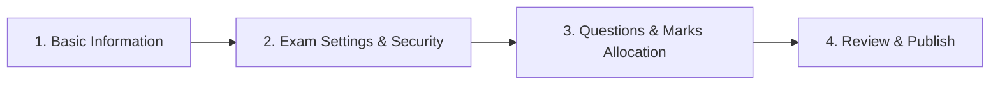

# Ducat Assessment Tool (CDT) - Master User Manual
## Complete Step-by-Step Guide for All Roles, Portals, Workflows & Intelligence Systems

---

## Table of Contents
1. [Introduction & Role-Based Access Overview](#1-introduction--role-based-access-overview)
2. [Authentication, Inactivity Timeout & Security Safeguards](#2-authentication-inactivity-timeout--security-safeguards)
3. [Administrator Dashboard (`/admin`)](#3-administrator-dashboard-admin)
4. [Faculty & Instructor Dashboard (Scoped View)](#4-faculty--instructor-dashboard-scoped-view)
5. [Candidate / Student Dashboard (`/dashboard`)](#5-candidate--student-dashboard-dashboard)
6. [Persistent Ongoing Exam Lockdown & Anti-Exit Environment](#6-persistent-ongoing-exam-lockdown--anti-exit-environment)
7. [Examination Creation Wizard (Admin & Faculty)](#7-examination-creation-wizard-admin--faculty)
8. [Local AI Exam Generator & Pre-Save Review Workbench](#8-local-ai-exam-generator--pre-save-review-workbench)
9. [Question Banks Management](#9-question-banks-management)
   - [9.1 Coding Question Bank & Mandatory Test Case Rules](#91-coding-question-bank--mandatory-test-case-rules)
   - [9.2 Standalone AI Coding Question Generator Modal](#92-standalone-ai-coding-question-generator-modal)
   - [9.3 MCQ Question Bank & Dynamic Options Builder](#93-mcq-question-bank--dynamic-options-builder)
   - [9.4 Standalone AI MCQ Question Generator Modal](#94-standalone-ai-mcq-question-generator-modal)
   - [9.5 Bulk Excel Question Ingestion & Validation Modals](#95-bulk-excel-question-ingestion--validation-modals)
10. [Student & User Management](#10-student--user-management)
11. [Faculty Management & Technology Scoping](#11-faculty-management--technology-scoping)
12. [Academic Hierarchy (Organizations, Technologies & Batches)](#12-academic-hierarchy-organizations-technologies--batches)
13. [Live Examination Interface & Anti-Cheat Environment](#13-live-examination-interface--anti-cheat-environment)
14. [Results, Scorecards & Advanced Intelligence Systems](#14-results-scorecards--advanced-intelligence-systems)
    - [14.1 Candidate Scorecards & PDF Report Cards](#141-candidate-scorecards--pdf-report-cards)
    - [14.2 Individual Candidate AI Review Modal](#142-individual-candidate-ai-review-modal)
    - [14.3 AI Cohort Performance Analysis & Institutional Intelligence Suite](#143-ai-cohort-performance-analysis--institutional-intelligence-suite)
    - [14.4 100% Local Ephemeral Privacy & Data-Cut Mechanism](#144-100-local-ephemeral-privacy--data-cut-mechanism)
    - [14.5 Institutional Accreditation Print Dossier](#145-institutional-accreditation-print-dossier)
15. [Troubleshooting & Frequently Asked Questions (FAQ)](#15-troubleshooting--frequently-asked-questions-faq)

---

## 1. Introduction & Role-Based Access Overview

The **Ducat Coding & Assessment Tool (CDT)** is an enterprise-grade examination, testing, and evaluation platform tailored for technical institutions, universities, and corporate assessment workflows. It provides a secure, automated sandbox for evaluating coding (C, C++, Java, Python, JavaScript, SQL) and multiple-choice questions (MCQs) with real-time AI/proctoring oversight.

### Role Hierarchy & Access Matrix

| Role | Portal URL | Primary Responsibilities | Data Scoping & Privacy |
| :--- | :--- | :--- | :--- |
| **Super Admin (`ADMIN`)** | `/admin/*` | Complete institutional control. Manages organizations, technologies, batches, users, faculty, question banks, scheduled exams, proctoring events, and system settings. | **Global View**: Can inspect and manage all branches, faculties, batches, and candidate results worldwide. |
| **Faculty / Instructor (`FACULTY`)** | `/admin/*` (Scoped) | Manages assigned academic streams and student cohorts. Creates exams, authors questions, monitors live candidate attempts, and evaluates grade sheets. | **Strict Batch Isolation**: Can **only** view batches, students, and exam submissions belonging to their assigned organization and technologies. Cannot see or modify another instructor's batches or student results. |
| **Candidate / Student (`STUDENT` / `USER`)** | `/dashboard`, `/exams/*`, `/results/*` | Takes official proctored assessments, accesses self-paced practice tests, writes and tests code in the sandbox editor, and inspects scorecards. | **Candidate Isolation**: Access is strictly limited to their own enrolled exams, historical submissions, and personal scorecards. |

---

## 2. Authentication, Inactivity Timeout & Security Safeguards

### How to Access the Platform
1. Open your web browser (Google Chrome or Mozilla Firefox recommended) and navigate to:
   ```
   https://<your-domain>/login
   ```
2. The login interface features:
   - **Dual-Mode Identifier Field**: Enter your **Student ID** (e.g., `STU-2026-001`), **Faculty ID** (e.g., `FAC-1002`), or **Registered Email Address**.
   - **Password Field**: Secure password input with eye icon toggle to reveal/hide plaintext.
   - **Theme Selector**: Toggle between **Dark Mode** and **Light Mode** at any time.

### Automated 2-Hour Inactivity Timeout
To protect unattended terminals in university computer labs:
- The platform tracks candidate and faculty interactions (mouse movements, clicks, keypresses, scrolls) across all browser tabs.
- If no user interaction is detected for **2 consecutive hours (7,200,000 ms)**:
  1. The server revokes the active session token.
  2. All local session credentials are wiped from `localStorage`.
  3. The user is redirected to the login screen with the notification:
     ```
     /login?reason=inactivity
     ```

### Strict Single Active Session Policy
> [!IMPORTANT]
> To eliminate credential sharing during examinations, CDT enforces a **Strict Single Active Session Guarantee**:
> - If an account is logged in from a second browser, device, or incognito window, the prior session is immediately invalidated.
> - The displaced session displays a `SESSION_TERMINATED` notification and redirects to `/login?reason=concurrent_session`.

---

## 3. Administrator Dashboard (`/admin`)

The Super Administrator command center provides an institutional-wide view of academic performance, real-time testing activity, and system throughput.

### Dashboard Key Modules
1. **Live Metrics Banner**:
   - **Total Candidates**: Total number of registered student profiles across all branches.
   - **Active Examinations**: Number of exams currently published and live for taking.
   - **Total Questions**: Combined tally of Coding and MCQ questions in the repository.
   - **Completed Evaluations**: Total count of evaluated student submissions.
2. **Real-Time Proctoring & Active Attempts**:
   - Displays real-time student sessions with indicators for fullscreen status and violation count.
   - Allows administrators to forcibly terminate or extend student attempts if required.
3. **Institutional Shortcuts**:
   - Quick launch buttons for **Exam Wizard**, **Local AI Exam Generator**, **New Coding Problem**, **New MCQ Question**, **Bulk Excel Upload**, and **AI Results Intelligence**.

---

## 4. Faculty & Instructor Dashboard (Scoped View)

When an instructor logs in, their workspace is automatically filtered to their specific academic assignments.

### Faculty Guardrails:
1. **Isolated Batch Management**: Faculty only see and manage batches that they created or that are explicitly assigned to them (`My Batches`). Other instructors' batches in the same organization remain completely private and hidden.
2. **Batch-Isolated Results Access**: Faculty can only inspect exam submissions, scorecards, and grade books for their own batches and assigned students. Another faculty member cannot view your batch's results even within the same organization.
3. **Question Authoring**: Faculty can create coding and MCQ questions for their assigned technologies, which can be reused in institutional exams.
4. **Targeted Assessment Scheduling**: Faculty can schedule exams targeting only their specific student batches.

---

## 5. Candidate / Student Dashboard (`/dashboard`)

The student portal provides an uncluttered, modern interface focused on assessment readiness:

### 1. Active & Upcoming Examinations (`/exams/available`)
- Displays all published exams assigned to the student's Organization, Technology, and Batch.
- Each assessment card displays:
  - **Title & Description**
  - **Duration** (e.g., `60 Mins`)
  - **Passing Marks & Total Marks** (e.g., `Passing: 40 / 100`)
  - **Scheduling Window** (Start Date & Expiration Date)
  - **Device Policy** (e.g., `Laptop/Desktop Required`)
  - **Action Button**: `Start Assessment` or `Resume Assessment` if within active window.

### 2. Practice Test Arena (`/exams/practice`)
- Self-paced practice tests for mastering C, C++, Java, Python, JavaScript, and SQL.
- Immediate evaluation with instant feedback on passed and failed test cases.
- Attempt limiter counters ensuring fair resource allocation.

### 3. My Assessment History & Results (`/results`)
- Chronological archive of all submitted examinations.
- High-level score summary badges (`PASSED`, `FAILED`, `EVALUATING`).
- Detailed breakdown link providing question-by-question marks and testcase analysis.

---

## 6. Persistent Ongoing Exam Lockdown & Anti-Exit Environment

> [!CAUTION]
> **Zero-Exit Anti-Cheating Policy**:
> Once a student clicks **Start Assessment** or enters an active exam, the platform enters a hardened session lockdown that persists until the exam is officially submitted or the countdown timer expires.

```
       Candidate Starts Assessment
                   │
                   ▼
       Active Session Flag Set in DB
                   │
    ┌──────────────┴──────────────┐
    ▼                             ▼
Browser Refreshed?          Tab Closed / Link Copied?
    │                             │
    ▼                             ▼
AuthContext Detects        Next Login / Route Check Detects
Active IN_PROGRESS Attempt  Active IN_PROGRESS Attempt
    │                             │
    └──────────────┬──────────────┘
                   │
                   ▼
  Forced Redirect to /exams/:id/take
   (Back buttons & other URLs locked)
                   │
                   ▼
  Candidate Resumes with Saved Code
```

### Key Lockdown Mechanisms:
1. **Automatic Ongoing Session Detection**:
   - Whenever an authenticated student visits any page or reloads the browser, `AuthContext` calls `GET /api/exams/active-session`.
   - If an `IN_PROGRESS` attempt exists with remaining time, the student is **immediately and automatically redirected** to `/exams/:id/take`.
2. **Total Navigation Interception (`App.jsx`)**:
   - The React router guard (`RequireAuth`) prevents navigating to `/dashboard`, `/exams/available`, `/results`, `/profile`, or `/settings`.
   - Any attempt to type or paste a different URL in the address bar is intercepted and immediately redirected back to the active test screen.
3. **Browser History & Back-Button Trapping**:
   - `CodingExamPage.jsx` manipulates the browser history stack (`window.history.pushState`).
   - If the student clicks the browser's **Back** or **Forward** button, the action is blocked, and an alert modal warns: *"You have an active ongoing exam session. You cannot leave this page until you finish and submit your exam."*
4. **BeforeUnload Guard & Tab Closure Warning**:
   - Closing the browser tab or window triggers a native `beforeunload` warning prompt: *"Assessment In Progress! Your exam will keep running on the server. Exiting will not pause the timer."*
5. **Continuous Code Autosave**:
   - The code editor saves candidate source code and MCQ selections to the browser's `localStorage` every few keystrokes.
   - The client asynchronously dispatches progress to `POST /api/exams/:id/save-progress` every 15 seconds. If the computer crashes or loses power, the candidate can reconnect on any device and resume with their exact saved code intact.

---

## 7. Examination Creation Wizard (Admin & Faculty)

**Route:** `/admin/exams/new` or `/admin/exams/edit/:id`

The **Exam Creation Wizard** is a 4-step guided builder designed to prevent configuration mistakes.



### Step 1: Basic Information
- **Assessment Title**: Official name of the test (e.g., `Java Spring Boot Mid-Term Examination`).
- **Organization**: Dropdown selecting the institution/client.
- **Target Technologies**: Multi-select pills choosing which technologies can take this exam.
- **Target Batches**: Select specific batches (or "All Batches") eligible for this test.
- **Instructions**: Custom honor code and rules displayed to candidates prior to starting.

### Step 2: Exam Settings & Security
- **Duration (Minutes)**: Server-enforced countdown timer (e.g., `60`).
- **Start Date & End Date**: Availability window during which students can initiate the exam.
- **Passing Marks**: Minimum score required to pass (Wizard validates that Passing Marks $\le$ Total Marks).
- **Proctoring Rules**:
  - **Max Allowed Violations**: Number of security alerts allowed (e.g., `5`) before automatic termination.
  - **Restrict to Laptop/Desktop**: Restricts exam access to screens $\ge 1024\text{px}$, blocking mobile devices.
  - **Allow In-Exam Code Running**: Toggle whether students can test their code with custom inputs during the exam.

### Step 3: Questions & Marks Allocation
- Filter the institution question bank by `ALL`, `CODING`, or `MCQ`.
- Click **Add (+)** to include questions into the exam paper.
- Customize **Marks** per question (e.g., `10` marks for Coding, `2` marks for MCQ).
- Reorder questions using drag or index order.
- The wizard dynamically updates the **Total Calculated Marks** at the top.

### Step 4: Review & Publish
- Overview summary showing total questions, total marks, passing threshold, and duration.
- Toggle between **Draft Mode** (saved but hidden from students) or **Active / Published** (live for eligible candidates).

---

## 8. Local AI Exam Generator & Pre-Save Review Workbench

**Route:** `/admin/exams/ai-generator`

The **Local AI Exam Generator** empowers administrators and instructors to synthesize complete, multi-section examination papers in seconds using 100% on-premises Ollama models (e.g., DeepSeek-Coder, LLaMA 3, Qwen, Mistral).

### Step-by-Step Workflow

#### 1. Ollama Daemon Health Verification
- The page automatically queries `GET /api/admin/ai/ollama/status` against `http://127.0.0.1:11434`.
- If Ollama is running, an **Ollama Active & Ready** green badge displays the count of installed local models.
- If Ollama is not detected, an interactive **Ollama Quick Setup Guide** explains how to start Ollama (`ollama serve`) and pull models (e.g., `ollama pull deepseek-coder:6.7b`).

#### 2. Configuration Parameters
- **Select Local Model**: Dropdown populated with installed models.
- **Assessment Topic**: Clear subject description (e.g., `Binary Search Trees, Graph Traversal & Dynamic Programming in Java & Python`).
- **Target Technologies**: Technologies eligible for this test (e.g., `Java`, `Python`, `Data Structures`).
- **Question Distribution**:
  - Number of Coding Questions (e.g., `2`) & Marks per Coding Problem (e.g., `20`).
  - Number of MCQ Questions (e.g., `5`) & Marks per MCQ (e.g., `4`).
- **Difficulty Level**: `BEGINNER`, `INTERMEDIATE`, or `ADVANCED`.
- **Target Organization & Batches**: Audience scope for the generated assessment.
- **Custom Pedagogical Instructions**: Optional prompt modifiers (e.g., *"Focus on edge cases with empty arrays and single-element inputs"*).

#### 3. Real-Time Generation Progress Pipeline
- Because local LLMs running on CPU or modest GPUs require time to synthesize complex code and test suites, the request includes an extended **10-Minute Timeout (600,000 ms)**.
- While processing, [`AiGenerationProgress.jsx`](file:///c:/Users/vansh/OneDrive/Desktop/CDT-Production/frontend/src/components/admin/AiGenerationProgress.jsx) renders a live visual progress pipeline:
  - **Model Initialization**: Connecting to local Ollama and establishing context.
  - **Structure Analysis**: Deconstructing syllabus, difficulty parameters, and problem distribution.
  - **Problem & Question Drafting**: Formulating statements, constraints, and initial code templates.
  - **Evaluation Suites**: Generating automated public/hidden test suites and options.
  - **Schema Validation**: Verifying strict JSON response format and normalizing languages.
  - **Live Elapsed Timer & Estimated Completion Bar**: Keeps the user informed so they know the system is actively working.

#### 4. Full Check & Edit Before Saving Workbench
> [!IMPORTANT]
> **Complete Pre-Save Editing Guarantee**:
> The AI generator **never** directly commits raw model output into the database. Instead, it presents an interactive full-screen review workbench where instructors can inspect, edit, and fine-tune every parameter before anything is saved:

- **Exam Header Configuration**:
  - Edit Assessment Title, Description, and Instructions.
  - Adjust Duration (mins), Passing Marks, and Max Allowed Violations.
  - Verify Target Organization, Technologies, and Batches.
- **Coding Questions Review Tab**:
  - **Language Normalization Check**: If the AI model produced an invalid language string (e.g., `"fullstack"`, `"c-program"`), CDT's engine automatically sanitizes and normalizes it into valid supported languages (`c`, `cpp`, `java`, `python`, `javascript`, `sql`). Instructors can add or remove supported languages with one click.
  - **Edit Problem Statement & Constraints**: Full textarea editors for Title, Description, Constraints, Input Format, and Output Format.
  - **Testcase Workbench**: Inspect all generated public and hidden test cases. Instructors can add new test cases, modify inputs/outputs, or adjust mark allocations.
- **MCQ Questions Review Tab**:
  - Edit Question Prompts and Options (A, B, C, D).
  - Radio button to toggle the correct answer key.
  - Edit educational explanations.
  - Delete or add questions as needed.
- **Commit Action**: Clicking **Save Exam & Questions to Database** creates the questions in the question bank, links them to the newly created exam, and redirects to `/admin/exams`.

---

## 9. Question Banks Management

### 9.1 Coding Question Bank & Mandatory Test Case Rules
**Routes:** `/admin/questions`, `/admin/questions/new`

#### Mandatory Policy for Coding Questions:
> [!IMPORTANT]
> - **Standard Coding Problems (C, C++, Java, Python, JavaScript)**: **MUST** contain at least:
>   1. **At least 1 Public Test Case**: Visible to candidates during code execution for debugging.
>   2. **At least 1 Hidden / Private Test Case**: Kept confidential on the server to prevent hardcoded solutions and ensure algorithmic correctness during final grading.
> - **SQL Problems (SQL Language Only)**: **Test Cases are OPTIONAL**. When only `SQL` is selected, administrators and faculty do not need to add any public or hidden test cases. Candidate queries are executed and validated directly against the database sandbox engine.

#### Configuring a Coding Problem:
1. **Title & Problem Statement**: Detailed problem description using markdown.
2. **Difficulty**: `EASY`, `MEDIUM`, or `HARD`.
3. **Allowed Languages**: Select from `C`, `C++`, `Java`, `Python`, `JavaScript`, `SQL`.
4. **Starter Code Templates**: Pre-fill boilerplate code for candidates for each language.
5. **Test Cases Tab**:
   - Add inputs and expected outputs.
   - Toggle the **Hidden** switch:
     - `OFF` = Public case (visible to student).
     - `ON` = Hidden case (evaluated during submission only).

### 9.2 Standalone AI Coding Question Generator Modal
**Location:** Button **"Generate with AI"** on `/admin/questions`

- Click **Generate with AI** to open [`AiCodingQuestionModal.jsx`](file:///c:/Users/vansh/OneDrive/Desktop/CDT-Production/frontend/src/components/admin/AiCodingQuestionModal.jsx).
- Specify topic (e.g., *Matrix Spiral Traversal*), difficulty, marks, and allowed programming languages.
- Features the live **AiGenerationProgress** tracker with a 10-minute timeout.
- Once generated, an interactive **Pre-Save Editor** opens:
  - Verify and edit problem statement, input/output specifications, and constraints.
  - Adjust allowed programming languages (with automatic language sanitization).
  - Review and edit generated sample cases and hidden test cases.
  - Click **Save Question to Bank** to persist to MongoDB.

### 9.3 MCQ Question Bank & Dynamic Options Builder
**Routes:** `/admin/mcq-questions`, `/admin/mcq-questions/new`
- Define multiple-choice questions with 4 or more options.
- Click the radio button next to the correct answer.
- Provide an optional explanation visible during result review.

### 9.4 Standalone AI MCQ Question Generator Modal
**Location:** Button **"Generate with AI"** on `/admin/mcq-questions`

- Click **Generate with AI** to open [`AiMcqQuestionModal.jsx`](file:///c:/Users/vansh/OneDrive/Desktop/CDT-Production/frontend/src/components/admin/AiMcqQuestionModal.jsx).
- Specify topic (e.g., *Python Generators & Memory Management*), difficulty, and question count.
- Once generated, an interactive **Pre-Save Editor** displays the synthesized questions:
  - Edit question text and option choices.
  - Change the selected correct answer radio.
  - Edit the explanation.
  - Save directly to the institutional MCQ question bank.

### 9.5 Bulk Excel Question Ingestion & Validation Modals
Admins and Faculty can upload hundreds of questions in seconds using standardized Excel `.xlsx` templates.
- Click **Download Excel Template** from the coding or MCQ questions page.
- Fill in the columns (`Title`, `Description`, `Difficulty`, `Input 1`, `Output 1`, etc.).
- Click **Upload Excel File**.
- If any row has a formatting error, a **Detailed Line-by-Line Error Modal** will appear indicating the exact row and column to fix.

---

## 10. Student & User Management

**Route:** `/admin/users`
- **Manual Provisioning**: Add a single student with Name, Student ID, Email, Organization, Technology, and Batch.
- **Bulk Excel Provisioning**: Upload an entire college batch with one spreadsheet.
- **Actions**:
  - Reset Student Password.
  - Suspend / Activate Student Account.
  - Edit Assigned Batch or Technology.

---

## 11. Faculty Management & Technology Scoping

**Route:** `/admin/faculty`
- Available to Super Admins to authorize instructors.
- Assign faculty to one or multiple organizations and technologies.
- Faculty IDs (e.g., `FAC-1002`) allow quick login alongside email authentication.

---

## 12. Academic Hierarchy (Organizations, Technologies & Batches)

CDT uses a 3-tier academic hierarchy for granular access control:

```
Organization (e.g., Ducat Education)
 └── Technology (e.g., MERN Stack Development)
      └── Batches (e.g., BATCH-2026-MERN-01, BATCH-2026-MERN-02)
```

1. **Organizations (`/admin/organizations`)**: Represents branches, universities, or corporate clients.
2. **Technologies (`/admin/technologies`)**: Academic streams (Java, Python, Cloud Computing, etc.).
3. **Batches (`/admin/batches`)**: Cohorts of students who study and take exams together.

---

## 13. Live Examination Interface & Anti-Cheat Environment

**Route:** `/exams/:id/take`

When a student clicks **Start Assessment**, the browser locks down into an anti-cheat proctoring sandbox.

### The Exam Screen Layout
- **Left Panel**: Problem Statement, Constraints, Sample Inputs & Outputs, and MCQ Choices.
- **Top Header**: Live server-synchronized countdown timer, Question Navigation Palette, and Violation Badge.
- **Right Panel**: Full Monaco Code Editor (VS Code engine) with syntax highlighting, language selector, and code reset button.
- **Bottom Drawer**: Code Execution Console with tabs for **Public Cases**, **Custom Input**, and **Execution Output** (STDOUT/STDERR).

### Anti-Cheating & Proctoring Rules
The platform continuously monitors student behavior and logs security events:
1. **Fullscreen Enforcement**:
   - The exam automatically enters fullscreen mode.
   - If the student presses `ESC` or exits fullscreen, a blocking overlay appears and logs an alert.
2. **Tab Switching & Window Blur Detection**:
   - Switching browser tabs or clicking another application logs a violation.
3. **DevTools & Inspection Blocking**:
   - Right-click context menus are completely disabled.
   - Key shortcuts `F12`, `Ctrl+Shift+I`, `Ctrl+Shift+J`, `Ctrl+U`, and `Ctrl+S` are intercepted and blocked.
4. **Automatic Termination**:
   - If violations reach the exam limit (e.g., `5`), the socket server instantly locks the attempt with a termination modal and submits the existing progress.

---

## 14. Results, Scorecards & Advanced Intelligence Systems

### 14.1 Candidate Scorecards & PDF Report Cards
**Routes:** `/results/:attemptId` (Student View), `/admin/results/:attemptId` (Admin/Faculty View)

- **Performance Badges**: `PASSED` (Green), `FAILED` (Red), or `EVALUATING` (Amber).
- **Testcase Output**: Displays passed vs. total hidden testcases, runtime in milliseconds, and memory consumption.
- **Branded PDF Export**: Clicking **Download PDF Scorecard** produces a publication-grade PDF report card with official school header, watermark, and QR verification stamp.

---

### 14.2 Individual Candidate AI Review Modal
**Location:** Button **"AI Candidate Review"** on Result Detail Page (`/admin/results/:id`)

When inspecting a student's attempt, instructors can click **AI Candidate Review** to launch [`AiCandidateReviewModal.jsx`](file:///c:/Users/vansh/OneDrive/Desktop/CDT-Production/frontend/src/components/admin/AiCandidateReviewModal.jsx).
- The local AI model inspects the student's submitted source code line-by-line against the hidden testcases.
- Synthesizes:
  - **Algorithmic Correctness & Logic Diagnosis**: Explains why specific edge cases failed (e.g., off-by-one errors, unhandled negative inputs).
  - **Time & Space Complexity Audit**: Estimates actual Big-O runtime vs. optimal asymptotic bounds.
  - **Code Quality & Cleanliness**: Flags missing variable conventions, redundancy, or poor indentation.
  - **Personalized Remediation Plan**: Recommends 3 specific conceptual topics for the student to revise.

---

### 14.3 AI Cohort Performance Analysis & Institutional Intelligence Suite
**Location:** Button **"AI Cohort Performance Analysis"** on Results Management Page (`/admin/results`)

[`AiResultsAnalysisModal.jsx`](file:///c:/Users/vansh/OneDrive/Desktop/CDT-Production/frontend/src/components/admin/AiResultsAnalysisModal.jsx) provides a deep, data-driven academic intelligence dashboard for administrators, department heads, and accreditation committees.

#### Granular Filter Scoping
Instructors can apply any combination of filters on the Results table:
- **By Examination**: Focus on a specific mid-term or final exam.
- **By Technology**: Filter for `Java`, `Python`, `MERN`, etc.
- **By Batch**: Filter for specific student cohorts (e.g., `BATCH-2026-A`).
- **By Gender**: Compare gender-based performance trends.
- **By Result Status**: Analyze all candidates, passed only, or failed only.

Clicking **AI Cohort Performance Analysis** sends the filtered cohort dataset to the local Ollama model to generate an exhaustive institutional dossier.

#### Intelligence Modules Generated:
1. **Executive Cohort Overview**:
   - Total attempts evaluated, overall pass percentage, mean score, top score, lowest score.
2. **Score Distribution Breakdown**:
   - Candidates scoring `> 80%` (Distinction), `60% - 80%` (First Class), `40% - 60%` (Second Class), and `< 40%` (Below Threshold).
3. **Batch-by-Batch Comparative Benchmark**:
   - Side-by-side comparative table showing candidate count, pass rate, and average score across batches.
4. **Technology & Subject Breakdown**:
   - Proficiency ratings across programming languages and conceptual domains.
5. **Talent Placement Readiness Matrix**:
   - Classifies candidates into **Industry Ready** (suitable for placement drives) vs. **Needs Remediation**.
6. **At-Risk Remediation Roster**:
   - Explicit list of students scoring below 40%, identifying their specific failure points and assigned faculty action items.

---

### 14.4 100% Local Ephemeral Privacy & Data-Cut Mechanism

> [!IMPORTANT]
> **Complete Data Sovereignty & Zero Cloud Leakage**:
> - All AI features operate exclusively through the local Ollama instance (`http://127.0.0.1:11434`).
> - **Zero student data, test questions, or proprietary exam content ever leaves the institution's private server.** No data is ever transmitted to OpenAI, Google, Anthropic, or any third-party cloud.

#### The "Cut Data Sharing & Clear Session" Mechanism
- When an analysis is complete, instructors can click the red button:
  ```
  [ Cut Data Sharing & Clear Session ]
  ```
- **What this action does**:
  1. Instantly severs the communication link with the local AI model.
  2. Wipes all in-memory filtered student summaries and cohort prompts from RAM.
  3. Purges all transient session state in the browser.
  4. Returns the modal to a pristine disconnected state.

---

### 14.5 Institutional Accreditation Print Dossier

To satisfy university inspection bodies and accreditation standards (e.g., **NBA**, **NAAC**, **ABET**, **AICTE**):
- Instructors can click **Print Institutional Dossier** in the analysis modal.
- Formats the entire AI intelligence report into a formal, paper-optimized print layout:
  - Official Institutional Header and Department Title.
  - Date and Time of Report Generation.
  - Filter Scope Criteria (Exams, Batches, Technologies covered).
  - Executive Academic Summary and Performance Tables.
  - Remediation Action Plan.
  - **Formal Accreditation Sign-off Blocks**:
    - *Head of Department (HOD)* Signature & Stamp.
    - *Dean of Academic Affairs* Signature & Stamp.
    - *Internal Quality Assurance Cell (IQAC)* Verification Signature.

---

## 15. Troubleshooting & Frequently Asked Questions (FAQ)

### Q1: Why does the exam screen show "Desktop / Laptop Required"?
**Answer:** The administrator has configured this exam with `restrictToLaptop: true`. Mobile devices and narrow browser windows (< 1024px) are restricted to ensure code editor usability and prevent mobile split-screen cheating. Maximize your window or switch to a laptop.

### Q2: Why did an Excel upload fail?
**Answer:** CDT displays an error modal detailing the exact row and column that caused the failure (e.g., `Row 5: Missing Full Name`). Open the template, correct the specified row, and re-upload.

### Q3: What happens if a student loses internet connection during an exam?
**Answer:** The Monaco editor continuously saves code progress to the browser's local storage (`localStorage`). When the connection resumes, the student can refresh the browser, click **Resume Assessment**, and continue from where they left off.

### Q4: Why can't a coding question be saved?
**Answer:** CDT requires both at least **one public testcase** and **one hidden testcase** for standard coding problems. Ensure the toggle switch for at least one case is set to **Hidden** and at least one is set to **Public**. (Note: If only SQL is selected as the language, testcases are optional).

### Q5: What if Ollama shows "Ollama Offline / Unreachable"?
**Answer:** Ensure the Ollama daemon is running on your server or local machine:
```bash
ollama serve
```
Verify that the URL configured in the AI modal matches your daemon (default: `http://127.0.0.1:11434`). Also verify you have pulled at least one model:
```bash
ollama pull deepseek-coder:6.7b
```

### Q6: Can a student leave an ongoing exam to check their dashboard?
**Answer:** No. As long as an exam attempt is `IN_PROGRESS` and has time remaining, CDT's route guards and active session detectors will intercept any navigation attempt and redirect the candidate back to `/exams/:id/take`. The student must either click **Submit Exam** or wait for the countdown timer to expire.

### Q7: Why did AI Exam Generation take 2 minutes?
**Answer:** Local LLMs run directly on your server's CPU or GPU hardware without cloud acceleration. CDT includes a generous **10-minute timeout** and a real-time progress tracker (`AiGenerationProgress`) to ensure thorough testcase generation and schema validation without premature timeouts.

---

*Ducat Assessment Tool (CDT) &bull; Master User Manual &bull; Confidential & Proprietary*
